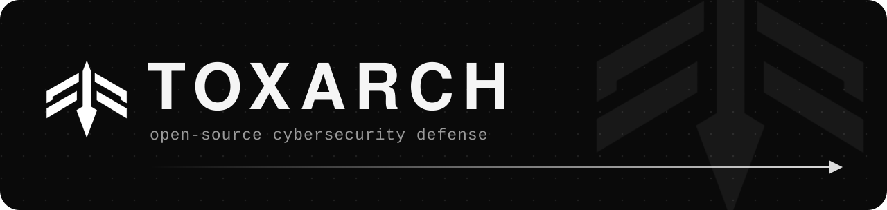

  

TOXARCH is an open-source security organization. We build defensive tools from scratch for edge devices, networks, and the systems between them. All code is public, so you can review it before you use it.

## What we work on

<table>
  <tr>
    <td width="50%" valign="top">
      <strong>Edge and IoT defense</strong> 
      Agentless monitoring for devices that cannot run security software.
    </td>
    <td width="50%" valign="top">
      <strong>Autonomous response</strong> 
      Detect a threat, limit its reach, and quarantine it automatically.
    </td>
  </tr>
  <tr>
    <td width="50%" valign="top">
      <strong>Wire-speed packet defense</strong> 
      eBPF, XDP, and raw sockets for filtering and deep packet inspection at line rate.
    </td>
    <td width="50%" valign="top">
      <strong>Attribution and accountability</strong> 
      Flow attribution across NAT, outbound abuse controls, zero-trust ingress, and tamper-evident audit logs.
    </td>
  </tr>
</table>

## How we build

- **From scratch.** If an existing tool fits, we link to it instead of rebuilding it.
- **In public.** Source, design notes, and limitations are open.
- **Small tools.** Clear interfaces and focused code instead of one large system.
- **Defense only.** No offensive tooling.
- **Real conditions.** Limited CPU, no agent, no maintenance window. If it only works in a lab, it is not finished.

## Get involved

The first projects are in early development. Browse the [repositories](https://github.com/orgs/ToxArch/repositories), open an issue with an idea, or send a pull request.

Contact: [toxarch0@gmail.com](mailto:toxarch0@gmail.com)

## Security

Report vulnerabilities privately to [toxarch0@gmail.com](mailto:toxarch0@gmail.com). Please do not open a public issue before a fix is available.

## License

Each project has its own open-source license. See the `LICENSE` file in that repository.
